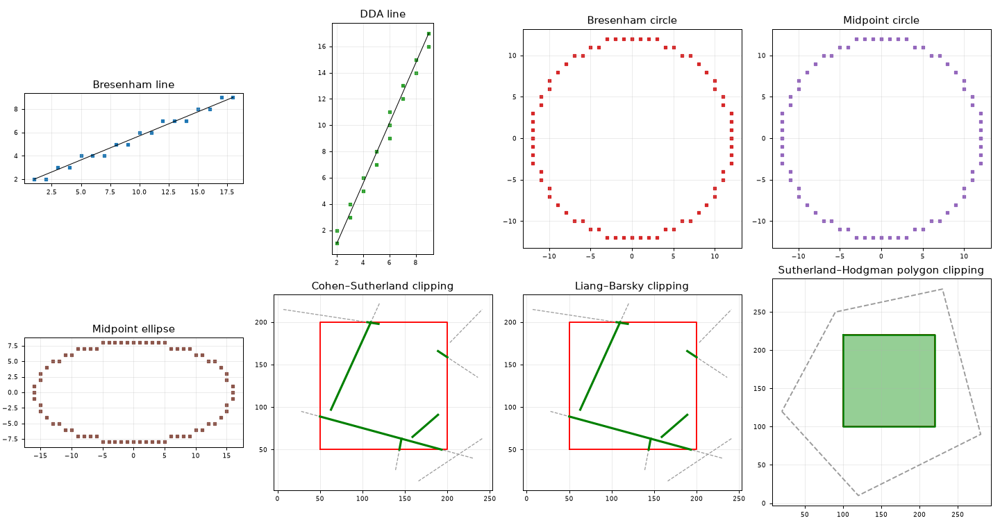

# Computer Graphics

Raster drawing and clipping algorithms from the Computer Graphics lab course, written in Python and drawn with Matplotlib.



## Algorithms

| Script | Algorithm | What you enter |
| --- | --- | --- |
| `dda_line.py` | DDA line drawing | The two end points |
| `bresenham_line.py` | Bresenham line drawing (integer arithmetic only) | How many random lines to draw |
| `bresenham_circle.py` | Bresenham circle, using 8-way symmetry | How many random circles to draw |
| `midpoint_circle.py` | Midpoint circle | How many random circles to draw |
| `midpoint_ellipse.py` | Midpoint ellipse, in two regions | Centre and radii of each ellipse |
| `cohen_sutherland.py` | Cohen–Sutherland line clipping with region codes | Nothing: clips 5 random lines |
| `liang_barsky.py` | Liang–Barsky parametric line clipping | Nothing: clips 5 random lines |
| `sutherland_hodgman.py` | Sutherland–Hodgman polygon clipping | Nothing: clips a random polygon |

## Run

Python 3.9 or later.

```bash
pip install -r requirements.txt
python bresenham_circle.py
```

## Tests

```bash
pip install -r requirements-dev.txt
python -m pytest
```

30 tests check what each algorithm should guarantee:

- Lines run from end to end without gaps.
- Every circle pixel is within half a pixel of the true circle.
- Ellipse points lie on the ellipse.
- Cohen–Sutherland and Liang–Barsky give the same result on 500 random lines.
- Polygon clipping keeps exactly the overlapping area.

GitHub Actions runs them on every push.
